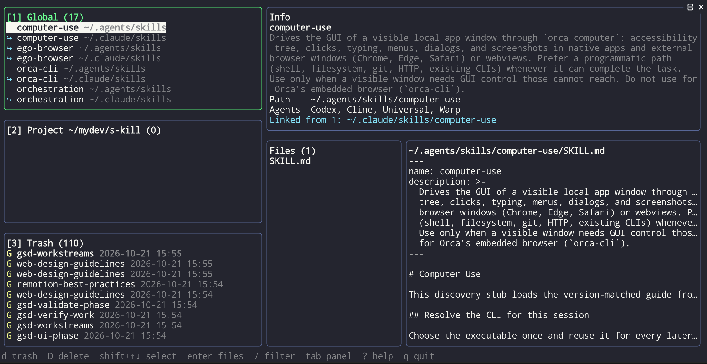

# s-kill

A terminal UI to **browse, inspect, trash and restore AI agent skills** scattered across global and project scopes
by 48 agents (Claude Code, Codex, Gemini CLI, Antigravity, Cursor, Copilot, OpenCode, …).



## Install

Requires Node.js 22+. Works in any terminal on macOS, Linux and Windows.

```sh
npm i -g s-kill     # then run `s-kill` anywhere
npx s-kill          # run once without installing
```

## Layout

Referring to the screenshot above:

| Area | What it shows |
|---|---|
| **[1] Global** (top left) | Skills installed under your home directory, each followed by its folder. `↪` marks a symlink, `✗` a broken link. A skill installed into several agent folders shows up once per folder (e.g. `computer-use` as the original in `~/.agents/skills` and a link in `~/.claude/skills`). |
| **[2] Project** (middle left) | Skills in the project around the current folder (nearest git root). The title shows the project path. |
| **[3] Trash** (bottom left) | Trashed skills with deletion time. `G` = trashed from global, `P` = from a project; a red `P` means the original project is gone, so it can't go back to its original location. |
| **Info** (top right) | Name, full description, real path, the agents that read this folder, and the links pointing to it. For trash items: original locations and whether they can be restored. |
| **Files** (bottom right, left) | File tree of the skill folder. Press `enter` to focus it and `j`/`k` to pick a file. |
| **Preview** (bottom right, right) | Contents of the selected file (`SKILL.md` by default). Scroll with `J`/`K`. |
| **Status bar** | Available keys, the filter, and results of the last action. |

The panel with the green border has focus.

## Usage

Run `s-kill` in a project folder. It scans:

- **Global** — per-agent skill folders under your home (`~/.claude/skills`, `~/.agents/skills`, `~/.codex/skills`, `~/.gemini/skills`, …)
- **Project** — skill folders in the nearest git root, or the current folder if there is none (`.claude/skills`, `.agents/skills`, …)
- **Trash** — `~/.s-kill/trash` (override with `S_KILL_TRASH`)

| Key | Action |
|---|---|
| `tab` `1` `2` `3` | Switch panel |
| `j` `k` `↑` `↓` `g` `G` | Move |
| `shift+↑` `shift+↓` | Select a range |
| `space` / `esc` | Toggle current item / clear selection |
| `enter` / `esc` | Open file list / go back |
| `J` `K` `^d` `^u` | Scroll preview |
| `/` | Filter by name |
| `d` | Move selection to trash (in Trash: delete permanently) |
| `D` | Delete the current skill permanently, skipping trash |
| `r` | Restore selected trash items |
| `R` | Refresh |
| `?` / `q` | Help / quit |

### Delete and restore rules

- Deleting a symlink removes only the link. The original stays.
- Deleting an original folder also trashes every link pointing to it; restoring brings them back together.
- Restore targets: **original location** / **global** / **current project**.
  - If a project skill's original project no longer exists, it can't go back to its original location, but it can go to global or the current project.
  - Run `s-kill` in another folder to put a trashed skill into that project.
  - Moving between global and project maps paths by agent rules (e.g. `~/.gemini/skills` → `.agents/skills`).
- Existing skills are never overwritten; the restore is refused instead.
- Multiple selections are processed together. Failures don't stop the rest and are listed afterwards. Items that can't return to their original location are skipped and the rest are restored.

Agent paths follow the [`gh skill install`](https://cli.github.com/manual/gh_skill_install) registry, plus Codex's own `~/.codex/skills` (`CODEX_HOME`). `CLAUDE_CONFIG_DIR`, `PI_CODING_AGENT_DIR` and `CODEX_HOME` are honored. Dot folders such as `.system` hold agents' built-in skills and are not shown.

## Development

```sh
npm i
npm run dev     # run with tsx
npm test
npm run build   # dist/
```

Release: `npm version patch && git push --follow-tags` → GitHub Actions tests on 3 OSes and publishes to npm (requires the `NPM_TOKEN` repo secret).
